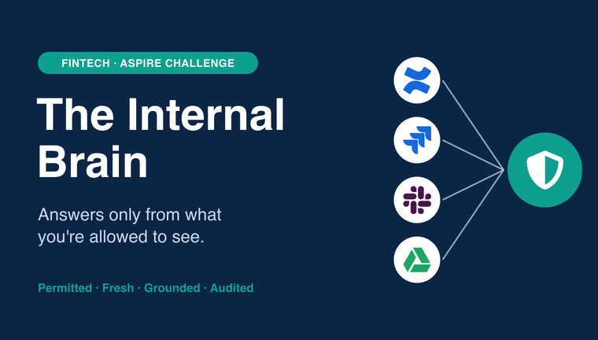

<!-- Structure follows othneildrew/Best-README-Template. -->

<a id="readme-top"></a>

<!-- PROJECT SHIELDS -->

[![CI][ci-shield]][ci-url]
[![Contributors][contributors-shield]][contributors-url]
[![Issues][issues-shield]][issues-url]
[![Last commit][last-commit-shield]][last-commit-url]
[![Tencent Cloud Hackathon][hackathon-shield]][hackathon-url]
[![FinTech track][track-shield]][hackathon-url]

<!-- PROJECT LOGO -->
<br />
<div align="center">
  <a href="https://github.com/pavan2184/tencent-hack">
    
  </a>

  <h3 align="center">Brain Sauce</h3>

  <p align="center">
    Enterprise answers from only what you're allowed to see.
    <br />
    Our entry for Aspire's <strong>"The Internal Brain"</strong> challenge, Tencent Cloud AI CAN DO
    IT Hackathon Singapore 2026 (FinTech track).
    <br />
    <a href="docs/ARCHITECTURE.md"><strong>Explore the docs »</strong></a>
    <br />
    <br />
    <a href="#demo-walkthrough">View demo</a>
    &middot;
    <a href="https://github.com/pavan2184/tencent-hack/issues/new?labels=bug">Report bug</a>
    &middot;
    <a href="https://github.com/pavan2184/tencent-hack/issues/new?labels=enhancement">Request feature</a>
  </p>
</div>

<!-- TABLE OF CONTENTS -->
<details>
  <summary>Table of Contents</summary>
  <ol>
    <li>
      <a href="#about-the-project">About The Project</a>
      <ul>
        <li><a href="#the-five-challenge-scenarios">The five challenge scenarios</a></li>
        <li><a href="#built-with">Built With</a></li>
      </ul>
    </li>
    <li>
      <a href="#getting-started">Getting Started</a>
      <ul>
        <li><a href="#prerequisites">Prerequisites</a></li>
        <li><a href="#installation">Installation</a></li>
        <li><a href="#run-without-docker">Run without Docker</a></li>
        <li><a href="#use-real-models">Use real models</a></li>
      </ul>
    </li>
    <li>
      <a href="#usage">Usage</a>
      <ul>
        <li><a href="#demo-walkthrough">Demo walkthrough</a></li>
        <li><a href="#rest-api">REST API</a></li>
        <li><a href="#mcp-for-ai-agents">MCP for AI agents</a></li>
        <li><a href="#make-targets">Make targets</a></li>
      </ul>
    </li>
    <li>
      <a href="#architecture">Architecture</a>
      <ul>
        <li><a href="#the-governed-pipeline">The governed pipeline</a></li>
        <li><a href="#repository-layout">Repository layout</a></li>
        <li><a href="#documentation">Documentation</a></li>
      </ul>
    </li>
    <li><a href="#testing">Testing</a></li>
    <li><a href="#roadmap">Roadmap</a></li>
    <li><a href="#contributing">Contributing</a></li>
    <li><a href="#license">License</a></li>
    <li><a href="#contact">Contact</a></li>
    <li><a href="#acknowledgments">Acknowledgments</a></li>
  </ol>
</details>

<!-- ABOUT THE PROJECT -->

## About The Project

[![Brain Sauce Ask page: a cited answer with 100% claim coverage][product-screenshot]](docs/images/ask-answer.png)

Staff at a multi-country fintech look for answers across Confluence, Jira, Slack and Google Drive.
Each of those tools has its own permission model. A chatbot on top of ordinary search fails a
regulated company in three ways:

1. **It leaks.** A contractor asks about Q3 revenue and the bot quotes the confidential board
   deck, because search never checked who was asking.
2. **It goes stale.** The failover runbook changed at the source, but the index still serves the
   old version as current.
3. **It cannot be audited.** Nobody can reconstruct what the model was shown, or why.

Brain Sauce is a governed knowledge layer over an "everything is a document" corporate brain.
Confluence pages, Jira issues, Slack logs, Drive files, emails and uploads all become
[GBrain][gbrain-url]-style pages. Every question, whether it comes from the web app, the REST API
or an AI agent over MCP, runs the same pipeline, so no channel can skip the checks. Each answer
comes with four guarantees:

- **Permitted.** Each platform's native permissions are checked per document **before any model
  call**. A local grant can never widen what the source allows. A document you cannot see returns
  the same `404` as one that does not exist.
- **Fresh.** Critical evidence is live-verified at the source, and stale versions are left out
  rather than shown as current. Each answer carries a freshness receipt.
- **Grounded.** Every claim cites its evidence and is checked against it, numbers and dates
  included. The system abstains when less than 60% of the answer is supported.
- **Audited.** A hash-chained event records the asker, the documents retrieved, every allow or
  deny decision and the answer. Compliance can replay it and verify the chain.

Revoking a grant in the app takes effect on the next question, and saved answers are re-checked
each time they are opened. A revocation at the source is enforced within five minutes for confidential
documents. Managers also get an **access map**: a live diagram of who can read each document,
and which platform rule or grant allows it.

[![Access map: who can read each document, and the rule behind every line][access-map-screenshot]](docs/images/access-map.png)

### The five challenge scenarios

Each scenario runs end to end as an automated test and as a step in `make smoke`, on a fully
synthetic corpus ("Example Harbor Finance").

| #   | Scenario                     | What you see                                                                                                                                                           |
| --- | ---------------------------- | ---------------------------------------------------------------------------------------------------------------------------------------------------------------------- |
| 1   | Unified query                | `john.tan` asks about the Rail-B cutover and gets one answer citing email, Jira, Slack, Drive and Confluence.                                                          |
| 2   | Bounded freshness            | The payment-rail failover runbook is v8 at the source but v7 in the index, so it is left out as stale. The current KYC runbook is cited.                               |
| 3   | Negative permission, no leak | `mei.chen` (contractor) asks for Q3 revenue and gets no figures, no title and no hint that the board deck exists.                                                      |
| 4   | Live revocation              | `root.admin` revokes the `leadership` grant. John's next answer no longer uses the deck, his saved answer is withheld, and his line to the deck leaves the access map. |
| 5   | Audit reconstruction         | `sam.lee` (auditor) replays the question, the retrieved documents and every decision, reveals the answer with a recorded reason, and verifies the hash chain.          |

The corpus also has one story for each access rule and freshness branch the pipeline enforces:
an ethical wall, an inherited Confluence restriction, expired and link-only Drive shares, an
inactive account, a page deleted upstream and a prompt-injection fixture. See
[`backend/seed/corpus/README.md`](backend/seed/corpus/README.md).

### Built With

[![Python][python-shield]][python-url]
[![FastAPI][fastapi-shield]][fastapi-url]
[![Pydantic][pydantic-shield]][pydantic-url]
[![PostgreSQL][postgres-shield]][postgres-url]
[![pgvector][pgvector-shield]][pgvector-url]
[![Redis][redis-shield]][redis-url]
[![Celery][celery-shield]][celery-url]
[![Next.js][nextjs-shield]][nextjs-url]
[![React][react-shield]][react-url]
[![TypeScript][typescript-shield]][typescript-url]
[![Tailwind CSS][tailwind-shield]][tailwind-url]
[![Docker][docker-shield]][docker-url]
[![MCP][mcp-shield]][mcp-url]
[![Tencent Cloud ADP][adp-shield]][adp-url]

<p align="right">(<a href="#readme-top">back to top</a>)</p>

<!-- GETTING STARTED -->

## Getting Started

The whole stack runs on one machine with Docker. The default mode uses a deterministic mock model,
so it needs no API keys or network access to any model provider.

### Prerequisites

- **Docker** with Compose v2 (`docker compose version`)
- **curl** and **jq**, for `make smoke`
- For local development and tests: [**uv**][uv-url] (it installs Python 3.12) and **Node.js 22**
  with npm
- Free host ports **3000** (web), **8000** (API and MCP), **5433** (Postgres) and **6380**
  (Redis). Port 80 is only used by the optional Caddy edge (compose profile `edge`).

### Installation

1. Clone the repository.

   ```bash
   git clone https://github.com/pavan2184/tencent-hack.git
   ```

   ```bash
   cd tencent-hack
   ```

2. Create your `.env`. Every value in `.env.example` is mock-safe.

   ```bash
   cp .env.example .env
   ```

3. Build and start Postgres, Redis, migrations, the API, the Celery worker and beat, and the web
   app. The command waits until the API reports healthy.

   ```bash
   make up
   ```

4. Load the personas, freshness policies and the synthetic corpus. This is idempotent, and it
   also restores the board-deck grant after a scenario 4 demo.

   ```bash
   make seed
   ```

5. Open <http://localhost:3000> and pick a persona in the header. The API is on
   <http://localhost:8000> (OpenAPI docs at `/docs`) and MCP is on <http://localhost:8000/mcp>.

6. Check the five scenarios end to end against the running stack.

   ```bash
   make smoke
   ```

> [!IMPORTANT]
> Keep the worker and beat containers running. Permission snapshots of confidential documents
> expire after five minutes and only a sync refreshes them, so without beat those documents go
> dark (decision D-018).

### Run without Docker

For quick UI work you can run the API with in-memory stores. It loads the seed corpus itself on
start-up and re-syncs permissions in the background (D-022).

```bash
cd backend && REPO_BACKEND=memory PROVIDER_MODE=mock CELERY_TASK_ALWAYS_EAGER=true uv run uvicorn app.main:app --port 8000
```

Then start the web app in a second terminal:

```bash
make dev-web
```

### Use real models

Generation can run on a published Tencent Cloud ADP app while retrieval keeps local deterministic
vectors (D-014), so no paid embedding service is needed. Set these in `.env`, then run `make up`
again:

```dotenv
PROVIDER_MODE=real
LLM_PROVIDER=tencent_adp_app
TENCENT_ADP_APP_KEY=<your ADP app key>
EMBEDDING_PROVIDER=local_hash
```

An OpenAI-compatible endpoint also works (`LLM_PROVIDER=openai_compatible` with `LLM_BASE_URL`,
`LLM_API_KEY` and `LLM_MODEL`). Real providers fail at start-up when a required key is blank.
Changing `EMBEDDING_DIM` needs `make reset`, which deletes the database volume.

<p align="right">(<a href="#readme-top">back to top</a>)</p>

<!-- USAGE EXAMPLES -->

## Usage

There is no login. Requests carry a persona id in the `X-Actor-Id` header (the web app's persona
switcher sets it), and the server resolves it to a principal. Never load real data into this demo.

| Persona        | Role in the story                          | Try                                                   |
| -------------- | ------------------------------------------ | ----------------------------------------------------- |
| `john.tan`     | Finance Ops manager, sees 23 of 24 pages   | scenarios 1, 2 and 4; the access map                  |
| `mei.chen`     | External integration contractor            | scenario 3: one shared file, nothing else             |
| `sam.lee`      | Internal auditor                           | scenario 5: the Audit page                            |
| `root.admin`   | Administrator (not a source-access bypass) | revoke the `leadership` grant on the Access page      |
| `alex.tan`     | Payments engineer                          | stale and deleted runbooks, the Orionix ethical wall  |
| `ravi.kumar`   | Payments SRE                               | walled off from the Orionix brief by an explicit deny |
| `daniel.wong`  | CFO                                        | the cutover approval, read through a bcc and a DM     |
| `nora.ibrahim` | Head of Compliance                         | owns the restricted STR register                      |
| `jordan.lim`   | Treasury analyst                           | private `#treasury-ops`, a finance-only Jira level    |

### Demo walkthrough

The Ask page shows each persona's demo questions as one-click chips.

1. As `john.tan`, ask **"What is the plan for the Rail-B cutover?"** Every claim cites a source
   across email, Jira, Slack, Drive and Confluence (scenario 1).
2. Ask **"What is the payment rail failover procedure and the KYC refresh cycle?"** The freshness
   receipt marks the failover runbook stale and omitted, and the KYC runbook is cited (scenario 2).
3. Switch to `mei.chen` and ask **"What were the Q3 board deck revenue figures?"** The system
   abstains, and a request for the deck's id returns the same `404` as a random id (scenario 3).
4. As `john.tan`, ask the board deck question (SGD 48.6 million). As `root.admin`, revoke the
   `leadership` grant on the deck, then ask again as John (scenario 4).
5. As `sam.lee`, open **Audit** to replay the last answer, reveal it with a reason and verify the
   chain (scenario 5).

More questions, one per access and freshness story, are in the
[seed corpus guide](backend/seed/corpus/README.md#questions-to-ask).

### REST API

Ask a question as the contractor:

```bash
curl -s http://localhost:8000/api/ask -H 'Content-Type: application/json' -H 'X-Actor-Id: mei.chen' -d '{"question": "What were the Q3 board deck revenue figures?"}' | jq '{answer, access_summary}'
```

The response is an `AnswerEnvelope` with `answer`, `claims`, `citations`, `freshness_receipt`,
`grounding`, `access_summary`, `timing` and an `audit_id`. Here the system abstains, and the
access summary counts only what Mei may read:

```json
{
  "answer": {
    "text": "There is not enough evidence to answer this question.",
    "abstained": true,
    "abstain_reason": "no evidence sentence matches the question"
  },
  "access_summary": {
    "principal_id": "mei.chen",
    "policy_version": "ac-v2",
    "allowed_count": 1,
    "evaluated_at": "2026-10-16T10:24:30.616368Z"
  }
}
```

Every non-2xx response is `{"error": {code, message, details, request_id}}`. The full contract
is in [`docs/API_CONTRACT.md`](docs/API_CONTRACT.md), and the live OpenAPI docs are at
<http://localhost:8000/docs>.

### MCP for AI agents

The MCP server (streamable HTTP at `/mcp`) exposes 18 tools named after GBrain's, including
`query`, `search`, `get_page`, `list_pages`, `put_page`, `capture`, `freshness_status`,
`verify_freshness`, `request_access` and `audit_lookup`. Each tool call runs the same services as
REST and is audited as `mcp.<tool>`. Pass the persona with the `X-Actor-Id` header, or with
`?actor=` when a client cannot set headers. For example, in Claude Code:

```bash
claude mcp add --transport http brain-sauce "http://localhost:8000/mcp/?actor=john.tan"
```

To check the server from the shell (`initialize`, `tools/list`, then `whoami`):

```bash
make mcp-smoke
```

### Make targets

| Target                  | What it does                                                            |
| ----------------------- | ----------------------------------------------------------------------- |
| `make up`               | Build and start the stack, wait for the API to be healthy               |
| `make down`             | Stop the stack                                                          |
| `make reset`            | Stop and delete volumes (database, Redis, uploads)                      |
| `make build`            | Build images                                                            |
| `make logs` / `make ps` | Tail logs / show service status                                         |
| `make migrate`          | Apply SQL migrations from `infra/postgres/migrations`                   |
| `make seed`             | Load personas, freshness policies and the synthetic corpus (idempotent) |
| `make test`             | Backend app and the three library suites, offline in mock mode          |
| `make test-app`         | Backend app tests only                                                  |
| `make test-lib LIB=…`   | One library: `groundedness`, `freshness` or `access_control`            |
| `make lint`             | Ruff (backend and libraries) and the frontend linter                    |
| `make fmt`              | Auto-format the backend                                                 |
| `make typecheck`        | Frontend TypeScript check                                               |
| `make dev-api`          | API with reload on the host                                             |
| `make dev-web`          | Next.js dev server                                                      |
| `make smoke`            | End-to-end REST smoke test against a running stack (`scripts/smoke.sh`) |
| `make mcp-smoke`        | MCP `initialize` → `tools/list` → `whoami`                              |
| `make lock`             | Regenerate `uv.lock` and `package-lock.json`                            |

<p align="right">(<a href="#readme-top">back to top</a>)</p>

<!-- ARCHITECTURE -->

## Architecture

### The governed pipeline

Every question runs through one pipeline in
[`backend/app/services/retrieval.py`](backend/app/services/retrieval.py). Denied documents stop at
the access gate: their text never reaches the model, and only the audit log records the decision.

```mermaid
flowchart LR
    Q["Question<br/>web · REST · MCP"] --> ID["Resolve principal<br/>X-Actor-Id"]
    ID --> S["Hybrid search<br/>tsvector + pgvector, 4× over-fetch"]
    S --> AC["Access gate<br/>native permissions per document"]
    AC --> F["Freshness<br/>live-verify critical, omit stale"]
    F --> SAN["Sanitize<br/>quarantine prompt injection"]
    SAN --> G["Compose<br/>one model call, temperature 0"]
    G --> V["Verify claims<br/>numeric and date gate"]
    V --> AB{"Supported<br/>≥ 60%?"}
    AB -- yes --> A["Audit event<br/>hash chain"]
    AB -- no --> ABS["Abstain"] --> A
    A --> E["AnswerEnvelope"]
```



The three hard problems live in three pure-Python libraries, one per team member. They depend on
Pydantic only and never import the app; the app implements their store Protocols against
Postgres in [`backend/app/adapters/`](backend/app/adapters/).

| Library                                          | What it decides                                                                                  |
| ------------------------------------------------ | ------------------------------------------------------------------------------------------------ |
| [`access_control`](backend/libs/access_control/) | Principals, raw per-platform permissions, grants, ordered policy rules R1–R10, no existence leak |
| [`freshness`](backend/libs/freshness/)           | Webhook, delta, reconcile and live-verify state machine; per-evidence freshness receipts         |
| [`groundedness`](backend/libs/groundedness/)     | Claims and evidence, deterministic support verification, abstention, prompt-injection screening  |

Grounding and verification are deterministic and model-free (D-013). There is one model call per
question and no LLM judge, so results are reproducible and easy on quota. If the model times out
(20 s deadline) or fails, an extractive composer answers instead and the audit event records it.

### Repository layout

```text
docker-compose.yml  Makefile  .env.example       one stack, mock-safe defaults
backend/
  app/                FastAPI app: core, db, schemas, api/routers, mcp, services, providers,
                      connectors, adapters (one file per library owner), tasks, tests
  libs/groundedness   claims ↔ evidence, support verification, abstention, injection screening
  libs/freshness      webhook/delta/reconcile/verify state machine and receipts
  libs/access_control principals, raw per-platform permissions, grants, policy rules
  seed/               personas, freshness policies, synthetic corpus (Example Harbor Finance)
frontend/             Next.js 15 UI: ask, documents, sources, access, access map, audit
infra/                Postgres init and numbered migrations, redis.conf, Caddyfile
scripts/              run_tests.sh, run_checks.sh, validate_env.sh, smoke.sh
docs/                 architecture, data model, API contract, testing, security, decisions
```

### Documentation

| Document                                                 | What it covers                                                 |
| -------------------------------------------------------- | -------------------------------------------------------------- |
| [Architecture](docs/ARCHITECTURE.md)                     | Stack, service and trust boundaries, the pipeline, Tencent ADP |
| [Data model](docs/DATA_MODEL.md)                         | Tables, frontmatter schema, migration ranges, the audit hash   |
| [API contract](docs/API_CONTRACT.md)                     | REST, `AnswerEnvelope`, MCP tools, webhooks, error codes       |
| [Decisions](docs/DECISIONS.md)                           | Architecture decision records D-001 onwards                    |
| [Testing](docs/TESTING.md)                               | Test strategy, scenario tests, how to run each suite           |
| [Security review](docs/SECURITY_REVIEW.md)               | Threats, mitigations and accepted demo risks                   |
| [Project status](docs/PROJECT_STATUS.md)                 | What is done, what is next, verification log                   |
| [Seed corpus](backend/seed/corpus/README.md)             | Personas, access and freshness stories, visibility matrix      |
| [GBrain mapping](docs/GBRAIN_MAPPING.md)                 | What was ported from GBrain and what was added                 |
| [Hackathon requirements](docs/HACKATHON_REQUIREMENTS.md) | Verified checklist, judging rubric, organiser timeline         |
| [Submission texts](docs/submission/SUBMISSION.md)        | Form answers, metrics and worked examples                      |
| [Architecture deck](docs/presentations/README.md)        | The submission slide deck and how to rebuild it                |

<p align="right">(<a href="#readme-top">back to top</a>)</p>

<!-- TESTING -->

## Testing

`make test` runs the backend app and all three library suites offline, with mock providers,
in-memory stores and eager Celery. On 16 October 2026 it gave **762 passed and 12 skipped**. The
12 skipped tests are the Postgres integration tests. They run with `-m integration` when
`DATABASE_URL` is set, and the first one migrates an empty database, so point them at a throwaway
Postgres rather than your demo stack ([`docs/TESTING.md`](docs/TESTING.md#test-commands)).

CI runs each test suite, Ruff, the frontend lint, typecheck and build, and a Compose file check on
every pull request.

<p align="right">(<a href="#readme-top">back to top</a>)</p>

<!-- ROADMAP -->

## Roadmap

- [x] Governed pipeline behind web, REST and MCP, with the `AnswerEnvelope` contract
- [x] Native permission semantics for Confluence, Jira, Slack, Drive, email and uploads (`ac-v2`)
- [x] Live revocation, including re-checks of saved answers (D-017) and five-minute snapshot expiry (D-018)
- [x] Live verification of critical evidence, with freshness receipts
- [x] Deterministic grounding with a numeric and date gate, and abstention (D-013)
- [x] Hash-chained audit with need-to-know and "reveal with reason" (D-019)
- [x] Access map for managers and admins (D-021)
- [x] Tencent Cloud ADP generation with local retrieval vectors (D-014)
- [ ] Credentialed, live connectors (the platform connectors are still stubs on a synthetic corpus)
- [ ] Sync real group memberships from Google Workspace and Atlassian
- [ ] Real authentication in place of the demo persona header
- [ ] Slack searched live with each user's own token, so nothing is stored
- [ ] Groundedness evals and a larger prompt-injection corpus
- [ ] Final upload and embedding budget caps (the current values are placeholders)

Hackathon milestones: submission deadline 16 October 2026, finalists announced 23 October 2026,
Singapore Hackathon Demo Day 3 November 2026 (TBC). See the
[open issues][issues-url] for proposed features and known issues.

<p align="right">(<a href="#readme-top">back to top</a>)</p>

<!-- CONTRIBUTING -->

## Contributing

Each team member owns one library, its app adapter and a migration range:

| Workstream     | Owner   | Library          | Adapter                       | Migrations |
| -------------- | ------- | ---------------- | ----------------------------- | ---------- |
| Groundedness   | Raphael | `groundedness`   | — (also owns the app core)    | 0300–0399  |
| Data freshness | Pavan   | `freshness`      | `adapters/freshness_store.py` | 0100–0199  |
| Access control | Chai    | `access_control` | `adapters/access_stores.py`   | 0200–0299  |

Core tables (`0001–0099`) belong to the foundation. Ground rules:

- **Only touch your library, your adapter and your migration range.** Changes elsewhere go
  through the core owner.
- **Libraries never import `app`.** Each library has a test that fails if its source does.
- **Migrations** are numbered, idempotent SQL files, one transaction each, and may reference only
  their own or lower ranges. Never edit an applied file.
- **Style:** Ruff (line length 100, Python 3.12), Pydantic v2 models and `StrEnum` vocabularies.
  `make lint` and `make test` must pass. Never remove a test to make a build pass.
- Record architectural decisions in [`docs/DECISIONS.md`](docs/DECISIONS.md) and update
  [`docs/PROJECT_STATUS.md`](docs/PROJECT_STATUS.md) after each meaningful change.

To propose a change:

1. Create a branch (`git checkout -b feature/short-name`)
2. Commit your changes (`git commit -m "feat(scope): what changed"`)
3. Push the branch (`git push origin feature/short-name`)
4. Open a pull request against `main` and wait for CI to pass

### Top contributors

<a href="https://github.com/pavan2184/tencent-hack/graphs/contributors">
  
</a>

<p align="right">(<a href="#readme-top">back to top</a>)</p>

<!-- LICENSE -->

## License

No licence has been chosen yet, so all rights are reserved by the authors. The page model and MCP
tool names follow [GBrain][gbrain-url], which is MIT-licensed; see
[`docs/GBRAIN_MAPPING.md`](docs/GBRAIN_MAPPING.md). All demo data is synthetic.

<p align="right">(<a href="#readme-top">back to top</a>)</p>

<!-- CONTACT -->

## Contact

| Name           | Workstream                                   | GitHub                                         |
| -------------- | -------------------------------------------- | ---------------------------------------------- |
| Raphael        | Groundedness, app core and integration       | [@Raphael2908](https://github.com/Raphael2908) |
| Pavan Madhu    | Data freshness, ingestion and Tencent deploy | [@pavan2184](https://github.com/pavan2184)     |
| Chai Pin Zheng | Access control                               | [@Ducksss](https://github.com/Ducksss)         |

Project link: <https://github.com/pavan2184/tencent-hack>

<p align="right">(<a href="#readme-top">back to top</a>)</p>

<!-- ACKNOWLEDGMENTS -->

## Acknowledgments

- [GBrain][gbrain-url], for the page model, `(source, slug)` identity and MCP tool names
- [Aspire](https://aspireapp.com/), for "The Internal Brain" challenge
- [Tencent Cloud Agent Development Platform][adp-url], for generation
- [Best-README-Template](https://github.com/othneildrew/Best-README-Template), for this README's
  structure
- [Shields.io](https://shields.io/) and [contrib.rocks](https://contrib.rocks/), for the badges and
  contributor graph

<p align="right">(<a href="#readme-top">back to top</a>)</p>

<!-- MARKDOWN LINKS & IMAGES -->

[ci-shield]: https://img.shields.io/github/actions/workflow/status/pavan2184/tencent-hack/ci.yml?branch=main&style=for-the-badge&label=CI
[ci-url]: https://github.com/pavan2184/tencent-hack/actions/workflows/ci.yml
[contributors-shield]: https://img.shields.io/github/contributors/pavan2184/tencent-hack.svg?style=for-the-badge
[contributors-url]: https://github.com/pavan2184/tencent-hack/graphs/contributors
[issues-shield]: https://img.shields.io/github/issues/pavan2184/tencent-hack.svg?style=for-the-badge
[issues-url]: https://github.com/pavan2184/tencent-hack/issues
[last-commit-shield]: https://img.shields.io/github/last-commit/pavan2184/tencent-hack.svg?style=for-the-badge
[last-commit-url]: https://github.com/pavan2184/tencent-hack/commits/main
[hackathon-shield]: https://img.shields.io/badge/Tencent_Cloud-AI_CAN_DO_IT_2026-0052D9?style=for-the-badge
[hackathon-url]: docs/HACKATHON_REQUIREMENTS.md
[track-shield]: https://img.shields.io/badge/Track-FinTech-1F6FEB?style=for-the-badge
[product-screenshot]: docs/images/ask-answer.png
[access-map-screenshot]: docs/images/access-map.png
[gbrain-url]: https://github.com/garrytan/gbrain
[uv-url]: https://docs.astral.sh/uv/
[python-shield]: https://img.shields.io/badge/Python_3.12-3776AB?style=for-the-badge&logo=python&logoColor=white
[python-url]: https://www.python.org/
[fastapi-shield]: https://img.shields.io/badge/FastAPI-009688?style=for-the-badge&logo=fastapi&logoColor=white
[fastapi-url]: https://fastapi.tiangolo.com/
[pydantic-shield]: https://img.shields.io/badge/Pydantic_v2-E92063?style=for-the-badge&logo=pydantic&logoColor=white
[pydantic-url]: https://docs.pydantic.dev/
[postgres-shield]: https://img.shields.io/badge/PostgreSQL_16-4169E1?style=for-the-badge&logo=postgresql&logoColor=white
[postgres-url]: https://www.postgresql.org/
[pgvector-shield]: https://img.shields.io/badge/pgvector-336791?style=for-the-badge&logo=postgresql&logoColor=white
[pgvector-url]: https://github.com/pgvector/pgvector
[redis-shield]: https://img.shields.io/badge/Redis-DC382D?style=for-the-badge&logo=redis&logoColor=white
[redis-url]: https://redis.io/
[celery-shield]: https://img.shields.io/badge/Celery-37814A?style=for-the-badge&logo=celery&logoColor=white
[celery-url]: https://docs.celeryq.dev/
[nextjs-shield]: https://img.shields.io/badge/Next.js_15-000000?style=for-the-badge&logo=nextdotjs&logoColor=white
[nextjs-url]: https://nextjs.org/
[react-shield]: https://img.shields.io/badge/React_19-20232A?style=for-the-badge&logo=react&logoColor=61DAFB
[react-url]: https://react.dev/
[typescript-shield]: https://img.shields.io/badge/TypeScript-3178C6?style=for-the-badge&logo=typescript&logoColor=white
[typescript-url]: https://www.typescriptlang.org/
[tailwind-shield]: https://img.shields.io/badge/Tailwind_CSS_v4-06B6D4?style=for-the-badge&logo=tailwindcss&logoColor=white
[tailwind-url]: https://tailwindcss.com/
[docker-shield]: https://img.shields.io/badge/Docker_Compose-2496ED?style=for-the-badge&logo=docker&logoColor=white
[docker-url]: https://docs.docker.com/compose/
[mcp-shield]: https://img.shields.io/badge/Model_Context_Protocol-111111?style=for-the-badge
[mcp-url]: https://modelcontextprotocol.io/
[adp-shield]: https://img.shields.io/badge/Tencent_Cloud_ADP-0052D9?style=for-the-badge
[adp-url]: https://www.tencentcloud.com/products/adp
